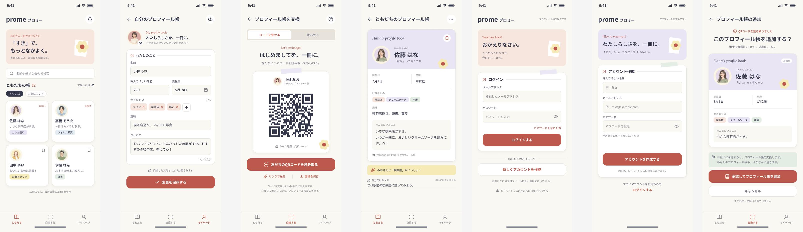

# prome 画面設計書

プロフィール帳をスマホで交換するアプリ「prome（プロミー）」の画面の概要をまとめる。DBの詳細は [database.md](database.md) を参照。



## 1. 画面一覧

| No | 画面 | 下部タブ | 主に使うデータ |
|---|---|---|---|
| 1 | ログイン | なし | Supabase Auth |
| 2 | アカウント作成 | なし | Supabase Auth、`profiles` |
| 3 | ホーム（ともだちの帳） | ともだち | `friendships`、`profiles`、`exchange_requests` |
| 4 | ともだちのプロフィール帳 | ともだち | `friendships`、`profiles` |
| 5 | 自分のプロフィール帳 | マイページ | `profiles`、Storage |
| 6 | プロフィール帳を交換 | 交換する | `exchange_codes`、`profiles` |
| 7 | プロフィール帳の追加 | 交換する | `preview-exchange-code`、`request_exchange` |

```text
ログイン ⇄ アカウント作成
   ↓
ホーム ─ カードをタップ → ともだちのプロフィール帳
交換 ─ コードを読み取る → プロフィール帳の追加 → 相手の承認待ち
マイページ → 自分のプロフィール帳
```

## 2. 各画面

### 1. ログイン

- **項目:** メールアドレス、パスワード（表示切り替えあり）
- **操作:** ログイン、パスワードを忘れた方、新しくアカウントを作成
- **補足:** メールアドレスは友だちに公開しないことを表示する。

### 2. アカウント作成

- **項目:** 呼んでほしい名前、メールアドレス、パスワード（半角英字と数字を含む8文字以上）。すべて必須
- **操作:** アカウントを作成、ログイン画面へ
- **処理:** 登録後はメールアドレスの確認に進む。確認後、プロフィールと交換コードが作られた状態で利用を始める。

### 3. ホーム（ともだちの帳）

- **表示:** 挨拶（`nickname`）、友だちの総数、友だちのカード
- **カード:** アバター、名前、`message` の省略表示、`likes` の先頭をタグで表示
- **カードの右上:** 未読なら「new!」、既読ならブックマーク
- **検索:** 名前と好きなもので、取得済みの一覧を絞り込む
- **絞り込みと並び順:** 「すべて」「お気に入り」を切り替え、交換が新しい順に並べる
- **ベル:** 自分宛ての `pending` の申請をRealtimeで受け取り、バッジを表示する

### 4. ともだちのプロフィール帳

- **表示:** ローマ字の名前、名前、呼び名、誕生日、星座（算出）、好きなもの、趣味、ひとこと、交換日
- **ブックマーク:** `friendships.is_favorite` を切り替える
- **メモ:** `friendships.memo` に保存する。相手には見えない
- **初回表示:** `first_viewed_at` を記録し、「new!」を消す
- **「…」メニュー:** 友だちの解除
- **未入力の項目:** 項目ごと非表示にする

### 5. 自分のプロフィール帳

- **項目:** アバター、名前、ローマ字の名前、呼んでほしい名前（必須）、誕生日（月日）、好きなもの（最大5つ）、趣味、ひとこと（100文字まで）
- **操作:** 変更を保存、目のアイコンで相手からの見え方を確認
- **補足:** 交換した友だちにだけ公開することを表示する。

### 6. プロフィール帳を交換

- **コードを見せる:** アバター、名前、QRコードを表示する
- **読み取る:** カメラでQRコードを読み取り、画面7に進む
- **操作:** リンクで送る、画像を保存、コードの再発行
- **QRコードの内容:** `prome://exchange?token=<token>`
- **補足:** 「？」でコードの使い方を表示する。リンクも読み取りと同じ流れで画面7に進む。

### 7. プロフィール帳の追加

- **表示:** コードの持ち主のアバター、名前、ローマ字の名前、呼び名、誕生日、星座、好きなもの、ひとこと
- **承認してプロフィール帳を追加:** `request_exchange` を呼び、相手の承認待ちにする
- **キャンセル:** 何も記録せずに戻る
- **注意書き:** 「お互いに承認すると、プロフィール帳を交換します。あなたのプロフィール帳も、○○さんに届きます。」
- **例外:** 自分のコード、すでに友だちの相手、申請中の相手、無効なコードの場合は、それぞれのメッセージを表示する。

## 3. モックからの変更点

| 箇所 | モック | 実装 | 理由 |
|---|---|---|---|
| 画面4の黄色い帯 | 「喫茶店がいっしょ！」を表示 | 作らない | 好きなものは自由入力で、表記が違うと一致しない |
| 画面3のカードのタグ | 「カフェ巡り」が好きなものにない | `likes` の先頭を表示 | データの出どころを1つにする |
| 画面3の下部の文言 | 「12冊のうち4冊を表示」 | 文言を削除し、全件をスクロール表示 | 検索のために全件を取得する |
| 画面5 | ローマ字の名前の入力欄がない | 任意の入力欄を追加 | 画面4と7で表示する |
| 画面6 | 再発行ボタンがない | 追加 | 漏れたコードを無効にする |

## 4. モックにないが必要な画面

| 画面 | 内容 |
|---|---|
| 届いた申請の一覧と承認 | ベルから開く。相手の情報を見て承認か拒否を選ぶ。注意書きは「承認すると、○○さんもあなたのプロフィール帳を見られるようになります。」 |
| 送った申請の確認と取り消し | 画面7の後に、相手の承認待ちの状態を確認し、取り消せるようにする |
| パスワードの再設定 | ログイン画面の「パスワードを忘れた方」から開く |
| メールアドレスの確認待ち | 登録後に表示する |
| 退会 | マイページから開く。確認画面に、取り消せないことと、友だちの帳からも消えることを表示する |
| ログアウト | マイページに追加する |
